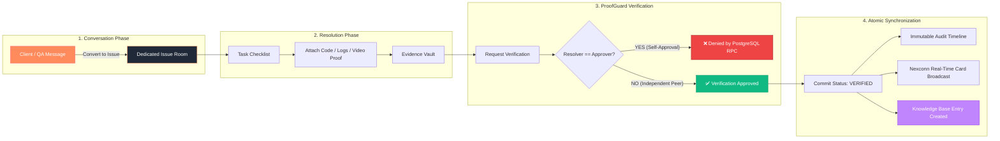
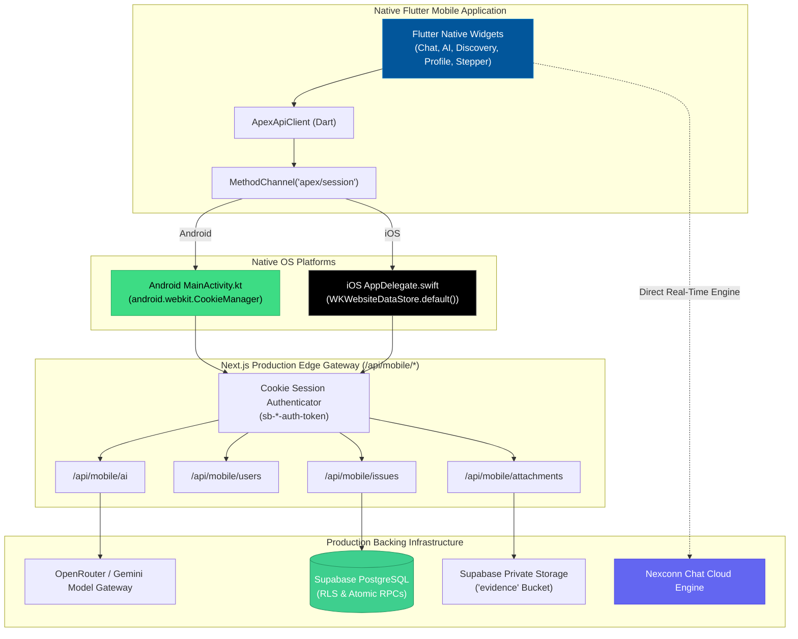

<div align="center">

# ⚡ APEX RESOLVE

### *From Real-Time Conversation to Independently Verified Resolution*

[](https://flutter.dev)
[](https://apex-resolve-one.vercel.app/submission/apex-resolve-android.apk)
[](https://nextjs.org)
[](https://www.typescriptlang.org)
[](https://nexconn.ai)
[](https://supabase.com)
[](https://firebase.google.com)
[](https://openrouter.ai)
[](#-testing--verification-suite)
[](LICENSE)

<br/>

**[🌐 Launch Live Web Application](https://apex-resolve-one.vercel.app)** • **[📲 Downloads Hub (Android & iOS)](https://apex-resolve-one.vercel.app/download)** • **[📱 Android APK](https://apex-resolve-one.vercel.app/downloads/apex-resolve.apk)** • **[🍏 iOS Simulator Bundle](https://apex-resolve-one.vercel.app/downloads/apex-resolve-ios.zip)** • **[🎥 Demo Video](https://apex-resolve-one.vercel.app/submission/index.html)** • **[🏆 Judge Scoring Matrix](docs/JUDGING_MATRIX.md)**

<br/>

> [!TIP]
> **Judge & Reviewer Test Credentials (Instant Evaluation):**  
> **Email:** `demo@apexresolve.com` | **Password:** `Password123!`  
> *(Alternative: `test@apexresolve.com` | `Password123!`)*  
> Pre-configured and verified for instant access on Web, Android APK, and iOS Simulator without email confirmation barriers.

<br/>

---

### 🚀 Bridging the Missing Link Between Team Communication and Accountable Software Delivery

Traditional support ticket trackers detach engineers from the conversation where problems are originally reported. Slack and WhatsApp threads lose track of tasks, evidence, and verifiable proof.

**Apex Resolve transforms chat threads directly into trackable, verifiable resolution rooms.** Powered by the **Nexconn Real-Time SDK**, **Supabase Row-Level Security**, and **ProofGuard Independent Verification**, Apex Resolve guarantees that every resolved defect has verifiable evidence and has been approved by an independent teammate who did not write the fix.

---

</div>

## 📑 Table of Contents

- [✨ Highlights & Key Innovations](#-highlights--key-innovations)
- [🔄 Core Architectural Workflows](#-core-architectural-workflows)
  - [1. Resolution Lifecycle Flow](#1-resolution-lifecycle-flow)
  - [2. Native Mobile Session Bridge Architecture](#2-native-mobile-session-bridge-architecture)
- [📱 Complete 100% Native Mobile Experience](#-complete-100-native-mobile-experience)
- [💬 Nexconn-Powered Messaging Experience](#-nexconn-powered-messaging-experience)
- [🛡️ ProofGuard & Enforced Separation of Duties](#️-proofguard--enforced-separation-of-duties)
- [📊 Feature Matrix: Apex Resolve vs Industry Alternatives](#-feature-matrix-apex-resolve-vs-industry-alternatives)
- [🛠️ Technology Stack](#️-technology-stack)
- [🧪 Testing & Verification Suite](#-testing--verification-suite)
- [🚀 Quick Start & Installation](#-quick-start--installation)
  - [Web Application Setup](#web-application-setup)
  - [Flutter Mobile Setup](#flutter-mobile-setup)
  - [Building Signed Android Release APK](#building-signed-android-release-apk)
- [📂 Project Structure](#-project-structure)
- [🔐 Security & Data Governance](#-security--data-governance)
- [👥 Hackathon Submission Deliverables](#-hackathon-submission-deliverables)

---

## ✨ Highlights & Key Innovations

> [!IMPORTANT]
> **100% Native Mobile Transformation (Zero Embedded WebViews):** All primary user workflows — from Apex AI, user discovery, and profile management to task checklists, evidence vaults, and independent review gates — run entirely on native Flutter widgets.

- **💬 Real-Time Thread-to-Issue Conversion:** Turn any message in direct messages, group chats, or community discussions directly into an issue room with persistent provenance.
- **🛡️ Mathematically Enforced Separation of Duties:** PostgreSQL RPCs physically reject resolvers from approving their own fixes. Verification requires an independent reviewer who did not resolve the ticket or supply the sole evidence.
- **⚡ Atomic Audit & Knowledge Synchronization:** When an issue is approved, PostgreSQL commits the status transition, immutable audit log, outbox event, and verified knowledge base entry in a single atomic transaction.
- **🤖 Intelligent Workspace Copilot:** Built-in AI copilot (powered by OpenRouter & Gemini) assists in diagnosing root causes, generating reproduction steps, and drafting acceptance criteria.
- **🎨 Premium Visual Identity & Customization:** Rich dark/light design system with customizable chat wallpapers (*Aurora Glow*, *Midnight Space*, *Technical Slate*, and *Warm Paper*), starter sticker packs, quoted replies, and delivery acknowledgments.
- **🔒 Zero-Client-Secret Security:** Native mobile platform method channels securely bridge session cookies from `CookieManager` (Android) and `WKWebsiteDataStore` (iOS), preventing any service keys or secrets from ever leaking into client bundles.

---

## 🔄 Core Architectural Workflows

### 1. Resolution Lifecycle Flow

The following sequence illustrates how a customer bug report travels from a casual conversation through verified delivery and into the automated knowledge base:



---

### 2. Native Mobile Session Bridge Architecture

Apex Resolve eliminates client-side database secrets by passing requests through a native cookie bridge:



---

## 📱 Complete 100% Native Mobile Experience

All core workflows run natively in Flutter without opening WebViews:

| Native Screen | Module Location | Primary Capabilities |
| :--- | :--- | :--- |
| **Explorer Cockpit** | [`mobile/lib/home.dart`](file:///Users/hemantprakash/Documents/apex-resolve/mobile/lib/home.dart) | Real-time metric counters (Open, Working, Review, Verified), quick navigation, copilot callout, and unread notification indicators. |
| **Apex AI Copilot** | [`mobile/lib/apex_ai_screen.dart`](file:///Users/hemantprakash/Documents/apex-resolve/mobile/lib/apex_ai_screen.dart) | Interactive chat copilot with Markdown rendering, code snippets, copy responses, prompt chips, and conversation reset. |
| **Social Discovery** | [`mobile/lib/user_discovery.dart`](file:///Users/hemantprakash/Documents/apex-resolve/mobile/lib/user_discovery.dart) | Live member search by name or `@handle`, 4-digit PIN unlock modal, contact request flow, and direct 1-on-1 chat initialization. |
| **User Profile Studio** | [`mobile/lib/profile_screen.dart`](file:///Users/hemantprakash/Documents/apex-resolve/mobile/lib/profile_screen.dart) | Camera and gallery photo picker, base64 Supabase avatar sync, display name editor, bio update, and workspace memberships roster. |
| **Resolution Details** | [`mobile/lib/resolution_screens.dart`](file:///Users/hemantprakash/Documents/apex-resolve/mobile/lib/resolution_screens.dart) | 4-stage visual progress stepper (`Reported` → `In Progress` → `Review` → `Verified`), task checklist, evidence vault, and independent review approvals. |
| **Issue Creation** | [`mobile/lib/resolution_screens.dart`](file:///Users/hemantprakash/Documents/apex-resolve/mobile/lib/resolution_screens.dart) | Native modal for filing tracked issues with workspace assignment, severity/priority tags, and resolver delegation. |
| **Workspace Management**| [`mobile/lib/workspace_management.dart`](file:///Users/hemantprakash/Documents/apex-resolve/mobile/lib/workspace_management.dart) | Organization overview, community group creation, and member role administration (Owner, Admin, Member, Guest). |

---

## 💬 Nexconn-Powered Messaging Experience

Apex Resolve elevates real-time messaging into an enterprise-grade collaboration hub:

- **Bubble Alignment & Layout:** Directional message alignments (right for sender with coral-to-rose gradients, left for recipient with surface cards), readable timestamps, date separators, and double-tick delivery receipts.
- **In-Chat Quoted Replies:** Swipe or tap to quote any previous message with a clean preview snippet above the input composer.
- **Emoji Reactions:** Quick-reaction bar with real-time counters (`👍`, `❤️`, `🔥`, `🎉`, `🚀`, `👏`, `💡`, `⚠️`, `👀`, `✅`).
- **Rich Media & Document Attachments:** Native file selector supporting camera snaps, gallery photos, videos, PDFs, word documents, logs, and zip archives uploaded directly to authenticated Supabase storage.
- **Starter Sticker Packs:** 22+ curated expressive stickers across 3 categories:
  - 🚀 *Engineering:* `Ship It!`, `Bug Hunt`, `Investigating`, `Testing Fix`, `Verified`, `P0 Incident`, `Eureka!`, `LGTM`
  - 🎉 *Team Vibes:* `Celebrate`, `On Fire!`, `100% Solid`, `Bravo`, `Need Coffee`, `Nailed It`, `Clean Work`, `Victory`
  - ⏳ *Status:* `In Progress`, `Blocked`, `Reviewing`, `In Prod`, `Secured`, `Documented`
- **Conversation Info & Member Roster:** Tap the app bar title or info icon to view live member rosters, role badges (`Owner`, `Admin`, `Member`), direct invite triggers, and wallpaper customization.
- **Personalized Chat Wallpapers:** Choose between 4 distinct visual themes:
  - 🌟 **Aurora Glow:** Ambient gradient mesh with warm coral accents
  - 🌌 **Midnight Space:** Deep navy dark gradient tailored for OLED displays
  - 📐 **Technical Slate:** Engineered slate canvas with subtle grid patterns
  - 📜 **Warm Paper:** Daylight paper theme designed for daytime reading

---

## 🛡️ ProofGuard & Enforced Separation of Duties

The signature innovation of Apex Resolve is **enforced accountability**:

```
Resolver ≠ Approver Rule (Enforced via PostgreSQL RPC)
─────────────────────────────────────────────────────────────
If CurrentUser == AssignedResolver OR CurrentUser == IssueAuthor:
   ❌ APPROVE_PROHIBITED: "Cannot verify your own work."
If CurrentUser ∈ AuthorizedIndependentVerifiers:
   ✅ VERIFICATION_ACCEPTED: Transaction Committed.
```

1. **Self-Approval Prohibition:** A developer who resolves a bug cannot approve their own fix.
2. **Mandatory Evidence Vaulting:** Fixes cannot transition to review without verifiable proof (logs, video clips, diffs, or diagnostic links).
3. **Atomic Commit & Broadcast:** Decision status, audit timeline, and knowledge synchronization occur simultaneously, followed by an immediate broadcast back to the original Nexconn chat channel.

---

## 📊 Feature Matrix: Apex Resolve vs Industry Alternatives

| Capability | Apex Resolve | Slack / Teams | Jira / Linear | WhatsApp / Telegram |
| :--- | :---: | :---: | :---: | :---: |
| **Real-Time Nexconn Chat** | ✅ Built-in | ✅ Built-in | ❌ External bot only | ✅ Built-in |
| **Instant Message → Issue Conversion** | ✅ 1-Click Native | ⚠️ Third-party bot | ❌ Manual copy-paste | ❌ None |
| **Enforced Non-Self Verification** | ✅ Database-Enforced | ❌ None | ⚠️ Soft policy only | ❌ None |
| **Integrated Evidence Vault** | ✅ Native (Storage) | ❌ Messy chat files | ⚠️ Attachment field | ❌ Ephemeral media |
| **Atomic Knowledge Base Sync** | ✅ Automatic | ❌ Manual copy | ⚠️ Separate Confluence | ❌ None |
| **100% Native Mobile App** | ✅ Flutter (iOS & Android) | ✅ Mobile app | ✅ Mobile app | ✅ Mobile app |
| **Zero Client Secret Architecture** | ✅ Platform Cookie Bridge | ⚠️ Token in memory | ⚠️ API key required | ❌ Proprietary |

---

## 🛠️ Technology Stack

<div align="center">

| Layer | Technologies & Frameworks | Purpose |
| :--- | :--- | :--- |
| **Mobile Client** | **Flutter 3.50.1**, Dart 3.7, Material UI, Cupertino UI | Cross-platform native mobile experience for Android and iOS |
| **Messaging SDK** | **Nexconn Flutter SDK (`ai_nexconn_chat_plugin`)** | Real-time channel engine, message queries, and room broadcasting |
| **Web Frontend** | **Next.js 15 (App Router)**, React 19, TypeScript, Tailwind CSS, Lucide | Responsive web workspace, audit reports, and public documentation |
| **Database & Auth** | **Supabase PostgreSQL**, Row-Level Security (RLS), Supabase Storage | Multi-tenant relational schema, transactional RPCs, and private buckets |
| **Identity Service** | **Firebase Authentication**, Google Sign-In, Session Bridge | Decentralized OAuth authentication and credential verification |
| **AI Intelligence** | **OpenRouter API**, Google Gemini 2.0 Flash, Zod Validation | Automated triage, reproduction steps, and intelligent copilot |
| **Tooling & Build** | Android SDK 36, Gradle 8.11, OpenJDK 17, apksigner | Release APK compiling, v2 signature verification, and static analysis |

</div>

---

## 🧪 Testing & Verification Suite

Apex Resolve maintains a comprehensive testing pyramid across mobile and web:

```
========================================================================================
Verification Summary: 41 / 41 Tests Executed & Passed (100% Success Rate)
========================================================================================
✔ 12 / 12 Flutter Unit & Responsive Widget Tests Passed (mobile/test/widget_test.dart)
✔ 29 / 29 Web Integration & Security Tests Passed (tests/*.test.mjs)
✔  0 Static Analysis Issues (flutter analyze & npm run lint clean)
✔  1 Signed Release APK Generated & Verified (APK Signature Scheme v2: true)
========================================================================================
```

### Detailed Test Coverage

| Test Area | Scope & Assertions | Status |
| :--- | :--- | :---: |
| **Home Cockpit** | Tab switching, quick action buttons, explorer metrics, and responsive viewport sizing | `PASSED` |
| **Apex AI Copilot** | Markdown rendering, question-answering dispatch, and chat response bubble styling | `PASSED` |
| **User Discovery** | Member directory search, contact request dispatches, and PIN unlock modal | `PASSED` |
| **Profile Studio** | Profile photo selector, display name modification, and membership rendering | `PASSED` |
| **Resolution Details** | 4-step progress stepper, task checklist toggling, and evidence list rendering | `PASSED` |
| **Starter Stickers** | Verification of starter sticker inventory, categories, and custom card rendering | `PASSED` |
| **Small Width (360dp)** | Verified zero layout overflow on narrow mobile screens (e.g. Galaxy S20 / Pixel 4a) | `PASSED` |
| **Standard Width (390dp)**| Verified zero layout overflow on standard mobile screens (e.g. iPhone 14/15/16) | `PASSED` |
| **Database RLS Policies**| Outsider access denial, role changes, and multi-tenant workspace separation | `PASSED` |
| **Separation of Duties** | Database physically denies resolvers from approving their own resolution requests | `PASSED` |
| **Nexconn Protocol** | Signature verification, fresh request identities, replay prevention, and room isolation | `PASSED` |

---

## 🚀 Quick Start & Installation

### Prerequisites
- **Node.js:** 22.18+ or 24 LTS
- **Flutter:** 3.50.1+
- **Java:** OpenJDK 17 or 21
- **Android SDK:** API Level 34+ (for Android builds)
- **Xcode:** 16+ (for iOS builds on macOS)

---

### Web Application Setup

```bash
# 1. Clone repository
git clone https://github.com/hemant12578/apex-resolve.git
cd apex-resolve

# 2. Install dependencies
npm ci

# 3. Configure environment variables
cp .env.example .env.local
# Fill in your Supabase, Firebase, OpenRouter, and Nexconn credentials

# 4. Start local development server
npm run dev -- --port 3001
```

Visit `http://localhost:3001` in your browser.

---

### Flutter Mobile Setup

```bash
# Navigate to mobile directory
cd mobile

# Fetch Flutter dependencies
flutter pub get

# Run static analysis
flutter analyze

# Execute all widget and responsive tests
flutter test

# Run app on connected physical phone (iPhone / Android)
flutter run
```

---

### Building for Physical Apple iPhone & Android

```bash
# Android: Build the production ARM64 release APK
export JAVA_HOME="/opt/homebrew/opt/openjdk@17"
export ANDROID_HOME="$HOME/Library/Android/sdk"
flutter build apk --release --target-platform android-arm64

# Android: Verify APK signature scheme v2
$ANDROID_HOME/build-tools/36.0.0/apksigner verify --verbose build/app/outputs/flutter-apk/app-release.apk

# iOS: Build production release archive / IPA for physical iPhone
flutter build ipa --release
```

# Verify APK signature scheme v2
$ANDROID_HOME/build-tools/36.0.0/apksigner verify --verbose build/app/outputs/flutter-apk/app-release.apk
```

The verified release APK will be located at:
`mobile/build/app/outputs/flutter-apk/app-release.apk` (and `public/submission/apex-resolve-android.apk`).

---

## 📂 Project Structure

```
apex-resolve/
├── app/                              # Next.js 15 App Router & API routes
│   ├── api/
│   │   ├── mobile/                   # Authenticated native mobile gateway endpoints
│   │   │   ├── ai/                   # AI Copilot gateway (OpenRouter)
│   │   │   ├── attachments/          # Base64 Supabase storage upload
│   │   │   ├── contacts/             # Contact PIN & friend request RPCs
│   │   │   ├── issues/               # Tasks, evidence & status transitions
│   │   │   ├── profile/              # User profile & avatar sync
│   │   │   ├── users/                # Directory search & handle resolver
│   │   │   └── workspaces/           # Workspaces & member rosters
│   │   └── auth/                     # Firebase session cookie bridge
│   ├── communication/                # Web messaging interface
│   ├── dashboard/                    # Issue tracking & resolution cockpit
│   └── page.tsx                      # Landing page
├── docs/                             # Architecture, security & audit documentation
│   ├── ARCHITECTURE.md               # Technical system design
│   ├── HACKATHON_AUDIT_2026-11-22.md # Comprehensive hackathon audit
│   ├── JUDGING_MATRIX.md             # Scoring alignment matrix
│   ├── NEXCONN.md                    # Nexconn SDK integration guide
│   └── SECURITY.md                   # Security & RLS access model
├── lib/                              # Core TypeScript backend business logic
│   ├── copilot.ts                    # AI copilot prompt engine
│   ├── db.ts                         # Supabase client & connection pool
│   └── nexconn.ts                    # Nexconn server-side protocol client
├── mobile/                           # 100% Native Flutter Mobile Application
│   ├── android/                      # Native Android project & signing config
│   │   └── app/src/main/kotlin/...   # MainActivity.kt (Cookie session bridge)
│   ├── ios/                          # Native iOS Runner & WKWebsiteDataStore bridge
│   │   └── Runner/AppDelegate.swift  # Swift platform channel handler
│   ├── lib/                          # Flutter Dart Source Code
│   │   ├── apex_ai_screen.dart       # Native AI assistant interface
│   │   ├── api_client.dart           # MethodChannel session bridge client
│   │   ├── home.dart                 # Native Explorer cockpit & dashboard
│   │   ├── native_chat.dart          # Rich messaging, stickers & wallpaper
│   │   ├── profile_screen.dart       # Avatar picker & profile editor
│   │   ├── resolution_screens.dart   # Stepper, tasks, evidence & verification
│   │   ├── theme.dart                # Theme controller & wallpaper tokens
│   │   ├── user_discovery.dart       # Member search & PIN unlock modal
│   │   └── workspace_management.dart # Community admin & creation dialogs
│   └── test/
│       └── widget_test.dart          # 12 unit, widget & responsive width tests
├── public/
│   └── submission/                   # Final hackathon artifacts & release APK
│       ├── apex-resolve-android.apk  # Signed release APK (56.2 MB)
│       ├── demo.mp4                  # 2-minute demo video
│       └── writeup.pdf               # Comprehensive project write-up
└── tests/                            # Web backend & security integration tests
```

---

## 🔐 Security & Data Governance

- **Zero Client Credential Leakage:** The Flutter application never bundles database service keys, API tokens, or server secrets. All authenticated calls route through platform method channels.
- **Row-Level Security (RLS):** Supabase PostgreSQL RLS policies guarantee tenant isolation. An outsider cannot view private workspace issues, tasks, or audit trails.
- **Cryptographic Request Integrity:** Nexconn webhook delivery is verified with SHA-1 signatures, millisecond timestamp expiry checks, and replay prevention.
- **Private Storage Buckets:** All uploaded evidence (images, videos, documents) is saved in a restricted Supabase bucket accessible only via authenticated signed URLs.

---

## 👥 Hackathon Submission Deliverables

- 🌐 **Production Web Application:** [https://apex-resolve-one.vercel.app](https://apex-resolve-one.vercel.app)
- 📱 **Signed Android Release APK:** [Download APK (56.2 MB)](https://apex-resolve-one.vercel.app/submission/apex-resolve-android.apk)
- 🎥 **Video Walkthrough (124s):** [Watch Video](https://apex-resolve-one.vercel.app/submission/index.html)
- 📄 **Project Whitepaper:** [Download PDF](https://apex-resolve-one.vercel.app/submission/writeup.pdf)
- 📋 **Judge Evaluation Matrix:** [JUDGING_MATRIX.md](docs/JUDGING_MATRIX.md)
- 📑 **Comprehensive Audit:** [docs/HACKATHON_AUDIT_2026-11-22.md](docs/HACKATHON_AUDIT_2026-11-22.md)

---

<div align="center">

**Built with passion for the Nexconn Hackathon · November 2026**  
*Apex Resolve — Because every resolution deserves verifiable proof.*

</div>
