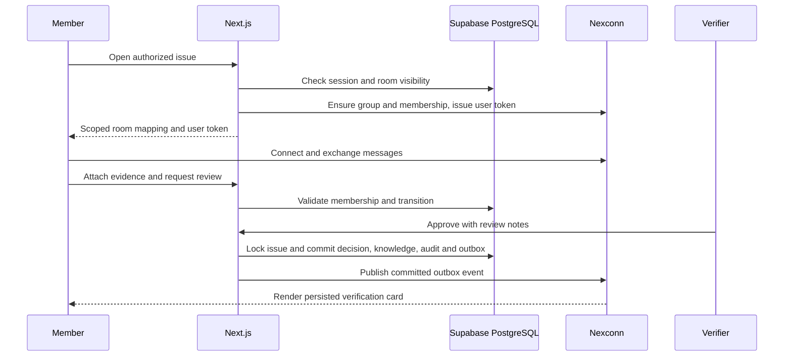

# Architecture

A single Next.js application serves the public site, authenticated workspace pages, server actions and API routes. The React room connects directly to the official Nexconn Web SDK for user messages. Server-only calls sign token, channel and workflow-message requests using the tenant secret.

## Persistence boundaries

Workspace membership gives team users workspace-wide issue access. Guests must also have an issue_participants row. SQL grants expose read access through RLS. Authenticated mutations run narrowly scoped RPCs. A verified issue's review, historical audit and searchable knowledge are committed together. Rejection preserves evidence and returns the issue to active work. Reopening removes the current knowledge entry until another approval.

A private Storage object carries the issue ID, evidence ID, and uploader metadata. The insert RPC verifies the object before creating a referenced evidence row. Downloads require issue access and expire after 60 seconds. The SQL file at the start of the migration series defines the tables, policies and workflow.

## Event and analysis boundaries

Outbox workers lease committed events using row locks. Deterministic provider channel IDs recover interrupted provisioning. The room merges SDK history and incoming events by identity, including duplicate deliveries of a workflow event. A scheduled worker can drain queued events while all browsers are closed.

A signed Nexconn webhook maintains bounded text context for server-side analysis. The browser never supplies arbitrary message history to a provider. After explicit consent the server retrieves scoped text, removes email addresses and common credential patterns, bounds the context, and reserves budget in PostgreSQL. A per-user context hash can reuse a successful analysis. Zod validates provider output before persistence. A separate, human-triggered RPC activates an edited task suggestion and records its provenance. [Chat integration details](NEXCONN.md)
